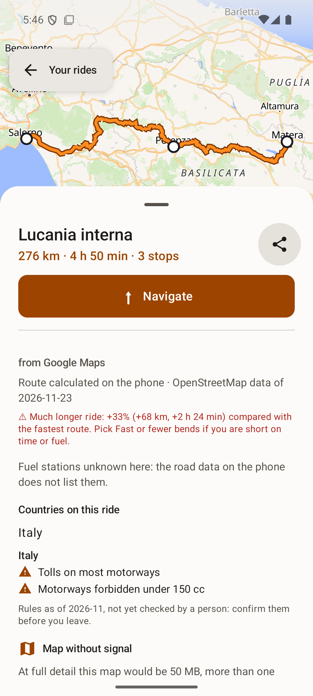
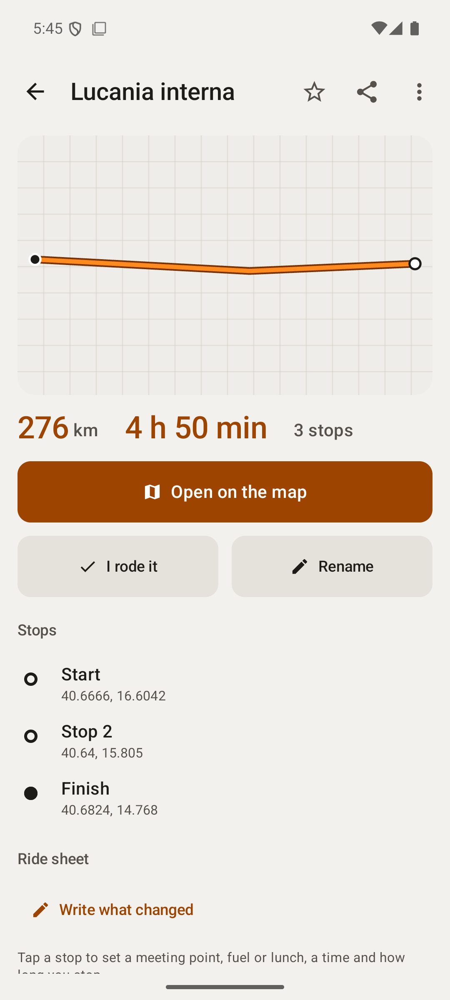
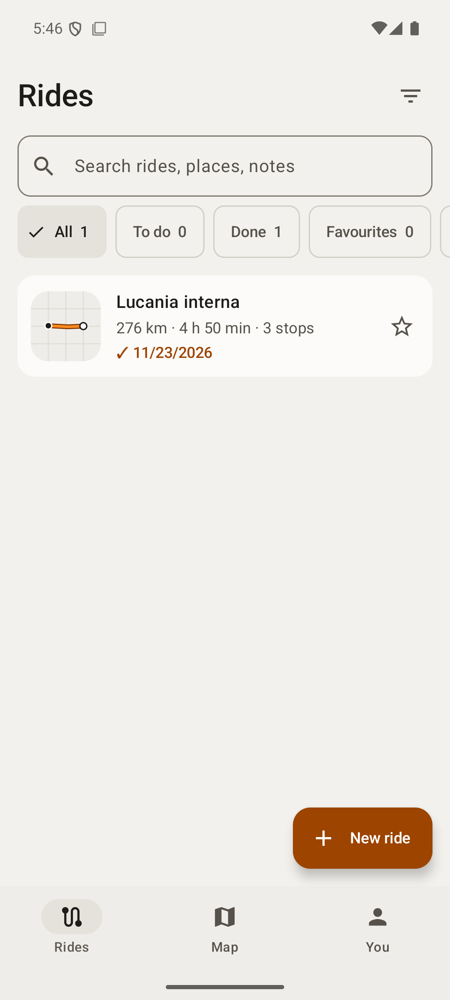

# RidePlan

**Motorcycle routes, from rider to rider.**
Plan the ride, share it with whoever you want, no account and no company in between.

[](https://buymeacoffee.com/nanunic9379)

> Status: beta, Android. Offline routing data covers Italy today; more areas are coming (#14).
> Android APK in the [Releases](https://github.com/NanuNic9379/RidePlan/releases): pick `arm64-v8a`.
> The app updates itself from the Releases (GitHub version).

<p>
  
  
  
</p>

## What it does today
- **Plan the ride** on the map: tap to add stops, drag them, or import a GPX, KML or Google Maps link.
- **Route computed on the phone** (Valhalla, motorcycle profile), offline once the area is downloaded:
  curves level, avoid motorways, tolls and ferries, riding modes, vehicle profile with engine size
  (under 150 cc no motorways).
- **Turn-by-turn navigation**, offline, with voice, speed limit, re-route when you leave the ride
  and an overview of the whole route without losing guidance.
- **Range and fuel stations** along the ride, from your tank size and consumption.
- **Unpaved stretches** and roads banned to motorcycles flagged on the ride.
- **Stops with duration and meeting times**, a ride sheet to decide whether to come,
  versioned ride updates ("v3: landslide on the SP12").
- **Multi-day trips** split into balanced days with overnight stops.
- **Per-country warnings** (vignettes, tolls, rules) for the countries the ride crosses;
  fixed speed camera data only where the law allows it (Italy).
- **Offline map for a single ride**, downloaded along the route.
- **Share from rider to rider**: QR code at the bar, link, or GPX file, with private zones that
  hide where you live.
- **GPX in and out**: routes come and go from Garmin, TomTom, Calimoto, Kurviger.
- **Languages and units**: English, Italian, German, French, Spanish; km or miles.

## Coming next
- More offline areas: Alps first, then France, Spain-Portugal, Germany-Austria-Switzerland, Balkans (#1, #14).
- Seasonal pass closures with an alternative route, and speed cameras in navigation (#13).
- Unpaved roads: avoid, allow or prefer, and a map layer (#9).
- Publishing rides on Nostr with an external signer, no servers of ours (#3, #11).
- Friends on the map during the ride and community rides (#16, #32).
- iPhone: the shared code builds for the simulator; a signed app needs the Apple Developer Program.

## What it will never do
- Ask for email, phone number or registration.
- Sell or collect location data.
- Ads.

## Documentation
- [Project and architecture](docs/PROJECT.md)
- [How to contribute](CONTRIBUTING.md)
- [Privacy](docs/PRIVACY.md): no data collected, what connects to the internet and why.
- [Social design](docs/social.md): Nostr identity, published rides, friends on the map, community (#3, #16, #32).
- [Routing and curves](docs/ROUTING.md), [unpaved and bans](docs/surface-and-bans.md), [pass closures and speed cameras](docs/pass-closures-and-speed-cameras.md)
- [Offline map of a ride](docs/OFFLINE-MAP.md), [worldwide coverage](docs/WORLDWIDE-COVERAGE.md), [country rules](docs/COUNTRY-RULES.md)
- [Stops and ride sheet](docs/stops-ride-sheet.md), [ride versions](docs/ride-versions.md)
- [Initial analysis](docs/ANALYSIS.md)
- [Security](SECURITY.md): how to report a flaw and verify the APK signature.

## License
GPL-3.0 (see [LICENSE](LICENSE)), with an additional permission for distribution on app stores
(see [LICENSE-STORE.md](LICENSE-STORE.md)).
Map data © OpenStreetMap contributors, ODbL license.

## Building

You need JDK 21 and the Android SDK (platform 37).

```
./gradlew :androidApp:assembleGithubDebug   # APK in androidApp/build/outputs/apk/github/debug
./gradlew :shared:testAndroidHostTest       # tests of the common code
```

Two Android flavors:
- `github`: the Release APKs. On startup it asks GitHub for the latest Release
  and, if it is newer, offers the update (#30). It is the only contact with GitHub:
  no data sent beyond the IP address of every web request. Off in debug builds.
- `fdroid`: without the in-app update and without the permission to install apps.

Releases are signed with a key that lives only in the repo secrets, never in the code.
Without those secrets the release build is signed with the debug key.

The iPhone app (`iosApp/`) builds only on macOS with Xcode; the pipeline builds it on every PR
for the simulator, unsigned.

## Support
RidePlan is free, open source and built in spare time. If it helped you find a better road,
you can [buy me a coffee](https://buymeacoffee.com/nanunic9379). Thank you!
