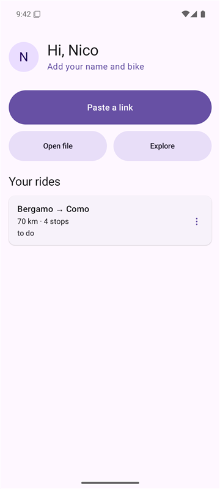
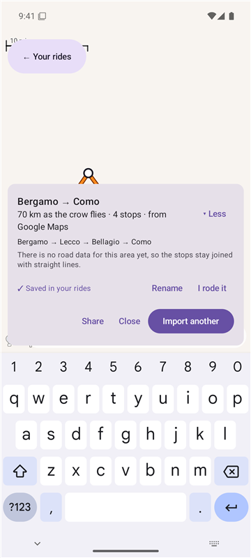
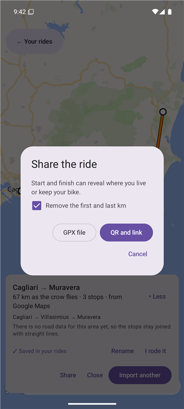
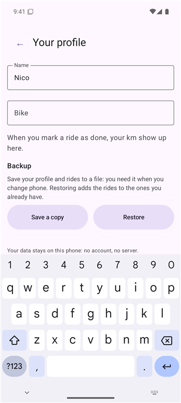
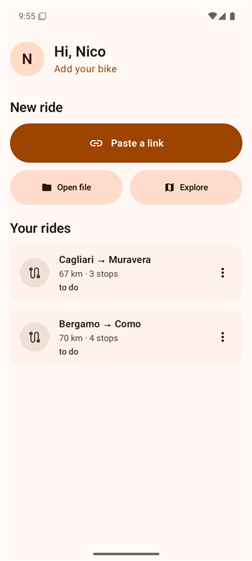
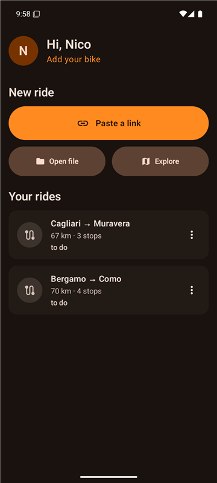
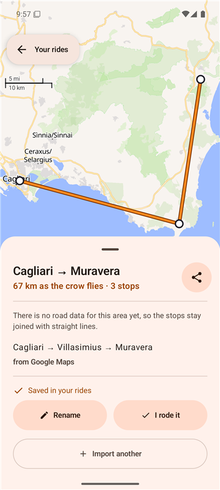
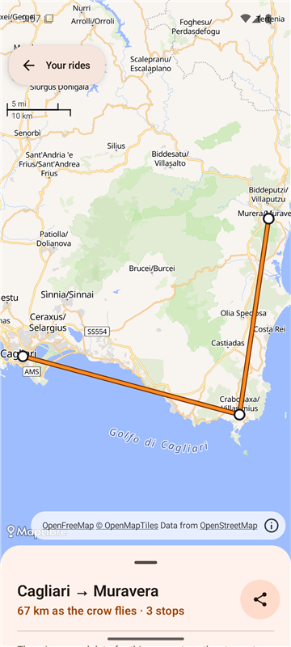
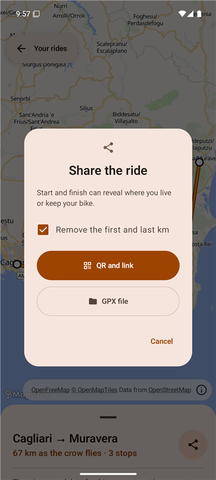
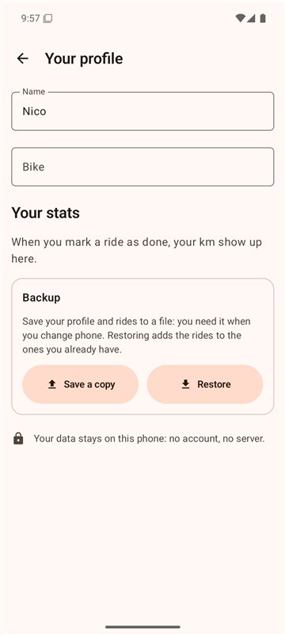

# RidePlan UX audit and design spec

Scope: the Compose Multiplatform UI in `shared/src/commonMain` (home, welcome, profile,
map with the open ride, share/QR/link dialogs, route state). The goal is **map first**, usable
**on a motorcycle**: with gloves, in direct sunlight, at a glance, in Material 3.

Screenshots were taken on a Pixel-class emulator (1080×2400, 420 dpi), English locale.
Full-size shots live outside the repo; the downsized ones below are in this folder.

## 1. Audit of the previous UI

| # | Problem | Why it matters on a bike |
|---|---------|--------------------------|
| A1 | Default purple Material baseline theme, no brand colour. The launcher icon is orange/ink/sky, the app was purple. | No identity; purple primary on a map full of greens and blues is weak at a glance. |
| A2 | The ride panel was a floating card glued to the bottom of the map, sized by hand, with the map framed through a "bounds margin" hack (bounds inflated by a guessed fraction). | The route was often hidden behind the card; framing depended on the screen size. |
| A3 | The panel covered the MapLibre attribution and logo; the "← Your rides" button overlapped the scale bar. | Attribution is a licence requirement of OpenStreetMap/OpenMapTiles; overlaps look broken. |
| A4 | Panel actions were small `TextButton`s in one row (Share · Close · Import another, then Rename · I rode it); text in `bodySmall`. | 40 dp text targets and 12 sp text are hard with gloves and in sunlight. |
| A5 | Unicode glyphs as icons: `←`, `⋮`, `✓`, `▾ Less`. The overflow `⋮` had no content description. | Glyph size depends on the font; TalkBack read "vertical ellipsis" or nothing. |
| A6 | Greeting subtitle said "Add your name and bike" even when the name was set. | Misleading prompt. |
| A7 | Route state (needs data / downloading / failed) was plain text plus a text button. | A decision (download 30 MB?) looked the same as a note. |
| A8 | Share dialog: two side-by-side text buttons plus Cancel in the button row, wrapping in German/French. | Small targets; long translations broke the layout. |
| A9 | "Close" on the ride panel duplicated system Back and "Your rides". | Three ways to do the same thing, one more small button. |
| A10 | Profile: `←` text button and a plain title instead of a top app bar. | Inconsistent with Android navigation. |

Before:

| Home | Ride on the map | Share | Profile |
|------|-----------------|-------|---------|
|  |  |  |  |

## 2. Information architecture and navigation

Unchanged on purpose (it already worked and is covered by `RideScreenState`):

```
Welcome (first launch only)
Home ── Profile
  │
  └── Map (Explore, or an opened ride)
        └── Ride sheet ── Share ── QR / GPX
```

- System Back: sheet expanded → map → home (handled in `MainActivity` via `rides.goHome()`).
- On the map the only chrome is **one** back button ("Your rides", top-left) and, on an empty
  map, **one** FAB ("Import a ride", bottom-right). Everything else is the sheet.

## 3. Map first: the ride bottom sheet

`MapScreen` (in `App.kt`) is now a Material 3 `BottomSheetScaffold`.

- **Peek** (collapsed) = drag handle + measured header + navigation-bar inset. The header is
  measured with `onSizeChanged`, so the peek fits the real content in every language and font
  scale. The header shows title (2 lines max), `km · time · stops` in primary colour, and a
  56 dp tonal **Share** button: the one action you want at a glance.
- **Expanded**: route state, notes (stops, source), route preferences, saved state
  (Rename / I rode it), "Import another". Body height is capped at 50 % of the screen and
  scrolls, so the route is always visible above the sheet.
- The sheet state and `RideScreenState.panelOpen` are kept in sync both ways (the platform
  opens a new ride expanded; the user drags it; tapping the header toggles it, with an
  accessibility click label "Details" / "Less").
- **Framing**: the map's `viewportInsets` exclude the top button and the peek, so the scale bar
  and the attribution always sit in free space. After the sheet settles, `fitRide` uses
  `CameraFit(fitPadding = …)` with only the *extra* height the expanded sheet covers. The old
  bounds-margin hack is gone.
- Empty map: `viewportInsets` bottom also clears the FAB, so the attribution sits above it.

## 4. Visual design

### Colour

Seeded from the launcher icon: Orange `#FF8A1F`, Ink `#1C1B26`, Sky `#7FD3F0` (`ui/Theme.kt`, `Brand`).

| Role | Light | Dark |
|------|-------|------|
| primary / onPrimary | `#9C4400` / `#FFFFFF` (6.5 : 1) | `#FF8A1F` / `#2B1100` (7.5 : 1) |
| primaryContainer | `#FFDBC8` | `#763300` |
| tertiary (info, routing data) | `#00677F` | `#7FD3F0` (Sky) |
| surface / onSurface | `#FFF8F5` / `#221A15` | `#19120E` / `#F0DFD7` |
| onSurfaceVariant on surface | `#52443C` (8.8 : 1) | `#D7C2B9` |
| error | M3 baseline | M3 baseline |

- Light primary is the dark orange so white text passes WCAG AA (≥ 4.5 : 1) with margin;
  dark mode uses the real brand orange, which is bright enough on near-black (7.8 : 1).
- Route line on the map: Brand Orange with an Ink casing, so it reads on both green land and
  blue sea, and is not confused with OpenFreeMap's yellow/orange roads at low zoom thanks to the casing.
- Warm-tinted surfaces (`surfaceContainer*`) instead of neutral grey give the sheet and cards
  a clear edge against the map.

### Type

Material 3 default scale (Roboto on Android), with **SemiBold** headline/title/labelLarge for
contrast in sunlight. Minimum body text in the app is `bodyMedium` (14 sp); `bodySmall` is no
longer used for content. Ride title `titleLarge`, stats `titleMedium` in primary colour.

### Shape

6 / 10 / 16 / 24 / 28 dp (extra-small → extra-large). Buttons stay fully rounded (M3 default).

### Icons

No icon library dependency: `ui/Icons.kt` holds 17 Material Symbols paths as `ImageVector`s
(Back, Share, More, Link, File, Map, Check, Edit, Delete, Lock, Add, Download, Upload, Route,
Person, Warning, Qr). All unicode glyph "icons" were removed.

## 5. Touch targets (gloves)

`ui/Theme.kt` → `Touch.Min = 48.dp` (M3 minimum), `Touch.Glove = 56.dp` (RidePlan default).

- Every primary action is ≥ 56 dp tall: Paste a link (64 dp), Open file / Explore, Share,
  Download, Retry, Rename / I rode it, Import another, Save a copy / Restore, Start.
- Overflow and back icon buttons are 56 dp; menu items are 56 dp with leading icons.
- Two-up buttons split the width equally, so each is ≥ 160 dp wide on a 360 dp phone.

## 6. States

| State | Treatment |
|-------|-----------|
| No rides | Centred route icon in a 72 dp circle, title, help text. |
| Importing | `ImportStatus`: card in `surfaceContainerHigh` with progress. |
| Import error | Card in `errorContainer` with a warning icon and the message. |
| Route: needs data | `tertiaryContainer` card, download icon, size in the text, full-width 56 dp Download. |
| Route: downloading | Text with bytes, determinate progress bar, Cancel. |
| Route: computing / checking | Text + indeterminate bar; a thin bar also appears in the sheet header. |
| Route: failed | `errorContainer` card with a full-width Retry. |
| Route: not covered | Plain `onSurfaceVariant` text (not an error). |
| Preview (ride received by link) | Explanation + full-width "Save to my rides". |

## 7. Accessibility

- All icon-only buttons have content descriptions (Share, More, Back); decorative icons use `null`.
- Section titles are `heading()` in semantics; the ride sheet has a `paneTitle` ("Ride details").
- The sheet header has an `onClickLabel` so TalkBack says what tapping does.
- Contrast ratios above meet WCAG AA for all text roles in both themes.

## 8. After

| Home | Home (dark) | Ride, expanded | Ride, peek |
|------|-------------|----------------|------------|
|  |  |  |  |

| Share | Profile |
|-------|---------|
|  |  |

Before → after notes:

- **Home**: brand colours; "New ride" section with one primary action and two tonal ones,
  all with icons; ride rows with a status icon (route / checked), 2-line titles and a labelled
  56 dp overflow menu with icons; greeting asks only for what is missing ("Add your bike").
- **Map**: the route is framed in the free part of the map in both sheet positions; scale
  bar and attribution are never covered; "Your rides" is a surface FAB that reads on any tile.
- **Ride sheet**: draggable M3 sheet instead of a hand-made card; Share is a big tonal icon
  button in the header; Close removed (Back does it); Rename / I rode it are 56 dp tonal buttons.
- **Share**: icon header, stacked full-width buttons that survive long translations.
- **Profile**: top app bar with a proper Back icon, "Your stats" heading, stats in primary
  colour, backup in an outlined card with icons, privacy line with a lock icon.

## 9. Known gaps / next steps

- The routing data release (`cells.json` / `regions.json`) currently returns 404, so every ride
  shows "not covered": the download, progress, failure and route-preference UI could not be
  screenshotted on the emulator. They are implemented per section 6 and compile, but need a
  visual check once the data is published.
- Switching dark mode (a configuration change) recreates the activity and closes the open ride,
  because `RideScreenState` lives in the activity. Moving it to a `ViewModel` or saving it with
  `rememberSaveable` would fix it.
- The Android starting window uses `@android:style/Theme.Material.NoActionBar` (dark), so the
  first frames before Compose draws show a dark window with light status bar icons. A DayNight
  splash theme matching the surface colour would remove the flash.
- In the peek state a few pixels of the sheet body are visible behind the gesture bar; harmless,
  but the body could fade out while collapsed.
- Explore opens at zoom 3 where some tiles load slowly; starting from the last ride or the
  device location would be more useful.
